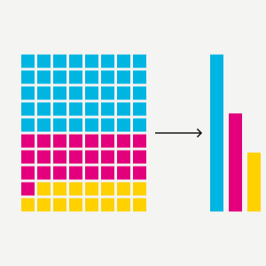
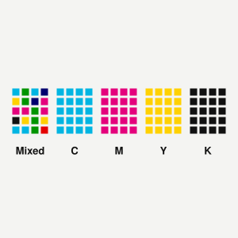
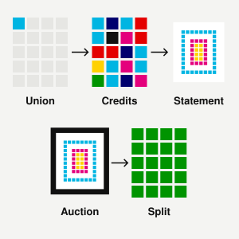
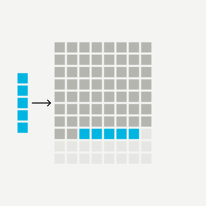
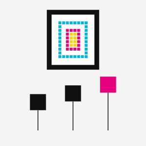
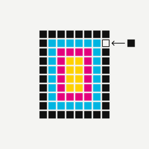

<a href="https://creditunion.fun"></a>

<p align="center"><b><a href="https://creditunion.fun">creditunion.fun</a></b> · <a href="#how-a-credit-union-works">How it works</a> · <a href="#security">Security</a> · <a href="https://creditunion.fun/docs">Docs</a> · <a href="contracts/ADAPTER.md">Adapter</a> · <a href="#deployed-addresses">Addresses</a></p>

# Credit Union

Credit Union turns Jack Butcher's [Credits](https://jack.art/credits) into $BALANCE and Statements. Put Credits into a batch of 80 (or pay ETH and the site buys them in): at 80 it burns into a Statement, the Statement converts into $BALANCE, and everyone in gets their share by the rating they put in. Or pool 80 in a Credit Union that auctions its Statement and splits the sale. Contracts hold the Credits, ETH and $BALANCE: no owner, pause or upgrade. Live on Ethereum mainnet since September 27, 2026; Union Jack became Statement #1 on October 1, and $BALANCE launched October 20.

**To use it:** open [creditunion.fun](https://creditunion.fun) and press Get BALANCE, or pick a Credit Union. The full guide is at [creditunion.fun/docs](https://creditunion.fun/docs). If the site is ever down, [creditunionfun.eth.limo](https://creditunionfun.eth.limo) bids, settles and claims through your own wallet.

<table>
<tr><td width="33%" valign="top"><br><b>Get $BALANCE</b><br>A full batch of 80 burns into a Statement, and the Statement becomes $BALANCE, split by the rating each of you put in.</td><td width="33%" valign="top"><br><b>Pick a color</b><br>Mixed batches take any Credit. C, M, Y and K take one ink only, and pay $BALANCE in that color.</td><td width="33%" valign="top"><br><b>Make a Statement together</b><br>Pool 80 in a Credit Union, auction the Statement, and split the sale.</td></tr>
<tr><td width="33%" valign="top"><br><b>Shop Credits</b><br>Every Credit for sale on OpenSea, FWA and CreditStrategy in one list, bought straight into a batch or union.</td><td width="33%" valign="top"><br><b>Bid on Statements</b><br>Bid on live auctions, buy listed Statements, or bid on several at once with Multibid.</td><td width="33%" valign="top"><br><b>Design it</b><br>Pick who can join and paint the sheet by trait, draw a picture with friends on the Printer, or burn 80 of your own.</td></tr>
</table>

## What's on the site

| Page | What you do there |
|---|---|
| [Home](https://creditunion.fun) | What the site does, over a live wall of Credits. |
| [Credits](https://creditunion.fun/credits) | Shop every Credit for sale (OpenSea, FWA, CreditStrategy) in one list, cheapest first, with each one's rating and the $BALANCE it makes. Browse the edition by Colors, Eights, Print, Weight, payment time and rating. Each Credit has its own page. |
| [Statements](https://creditunion.fun/statements) | Bid on live auctions, buy Statements listed on OpenSea, or [Multibid](https://creditunion.fun/statements/multibid): bid on several auctions in one step. Each Statement has its own page with its history. |
| [Balance](https://creditunion.fun/balance) | Buy $BALANCE with ETH by whichever way gets more: Uniswap at once, or a batch of 80 Credits that converts when it fills. Sell it back to the pool. Turn your own Credits into $BALANCE. Each Balance NFT has its own page. |
| [Start](https://creditunion.fun/create) | Open a Credit Union: who can join, the burn order, the split, the Statement's format. |
| [Make](https://creditunion.fun/make) | Burn 80 of your own Credits into a Statement you keep. No union, no auction. |
| [Printer](https://creditunion.fun/printer) | Upload a picture, add friends' wallets, and share one plan: each friend buys their Credits, and the 80 draw the picture as a Statement. |
| [Activity](https://creditunion.fun/activity) | Everything wallets have done on the site, newest first. |
| Member pages | Any wallet's Credits in wallet, what it has deposited, what's coming and what's ready to collect, at `/member/<address>`. |
| [Docs](https://creditunion.fun/docs) | The full guide. |

## How a Credit Union works

1. **Open.** Anyone with a Credit opens a Credit Union and sets its rules: who can join, the burn order, and the split (Equal or Early bird).
2. **Join.** Holders deposit Credits. Every deposit is checked onchain against the Credit Union's rules. No Credit? The Sweeper buys the cheapest fitting OpenSea listings and deposits them in one transaction.
3. **Leave.** Anyone can withdraw until the Credit Union locks. A full Credit Union counts down 5 minutes (leaving drops it to 79 and stops the clock), then locks for 1 hour, during which nobody can leave and anyone can burn. If nobody burns it, it unlocks: depositors can leave again, and anyone can call `restartCountdown()` for a fresh 5 minutes and hour.
4. **Burn.** During the locked hour, anyone calls `assemble()`. The 80 Credits go to Jack's Statements contract, through the burn adapter, in the Credit Union's order and the Credit Union must end up holding the Statement, or the call reverts.
5. **Auction.** 24 hours from the first bid. Each bid beats the last by 5% (minimum 0.01 ETH). A bid in the last 15 minutes moves the end to 15 minutes after that bid. Outbid ETH is refunded in the same transaction. The site opens Credit Unions with no reserve.
6. **Split.** Anyone settles. The Statement goes to the winner. A 2% protocol fee comes off the top, only if it sells. The rest goes to the 80 positions: 1/80 each (Equal), or a straight line from 1.5 shares for the first deposit to 0.5 for the last (Early bird). Settling pays every member in the same transaction. A member whose wallet won't take the payment keeps their share, and `claim` (callable by anyone for anyone) sends it later.

**Who can join.** Any combination of Jack's traits (Colors, Eights, Print, Weight, Plates, Bits), payment time, [rating](https://jack.art/credits/rating), a Credit-number range, or a named list of up to 200 Credits.

**Burn order.** The order Credits joined, Credit number (up or down), a painted sheet (the 8×10 grid painted by trait; each painted spot only takes a matching Credit), or a picture (an uploaded image, drawn by the Credits that match it best). The creator also picks the Statement's format.

**Reserve.** A Credit Union can be opened with a reserve (the site opens them with none): the first bid must meet it. If no bid comes within 7 days of the burn (`RESERVE_WINDOW`), the reserve lapses and the minimum first bid drops to 0.01 ETH.

## How $BALANCE batches work

$BALANCE is the token Jack's Statements convert into, launched October 20, 2026. Credit Union runs a second factory for it: the same `Batch` code with `TokenAdapter` as its assembler.

1. **Fill.** A batch takes 80 Credits. Mixed batches take any Credit; C, M, Y and K batches take only Credits printed in that one ink, since $BALANCE carries the ink of the Statement it comes from. Buy on the Balance page sweeps the cheapest Credits per rating point into a batch when that beats Uniswap by 3% or more.
2. **Convert.** At 80 the batch locks at once (no countdown). Its Credits burn into a Statement in a wallet of the batch's own (`TokenPocket`), and the Statement converts into $BALANCE there. No auction.
3. **Pay.** Members split the $BALANCE by the rating each put in, after the protocol and creator fees. Our token keeper converts and pays, gas only; `claim` is the fallback, callable by anyone.

Buys and sells through Uniswap on the site use BALANCE's pool and carry a 1% fee to the Safe.

## How the pieces fit

The contracts hold everything of value and decide every rule. Wallets sign every deposit, bid and claim in the
browser. The Worker behind the site caches chain reads, listings and art. Two keepers settle auctions, retry failed
payouts and convert full $BALANCE batches; their keys hold no role in any contract, so they can only do what anyone
could, and neither ever burns. If the site goes down, the [mirror](mirror/README.md) and Etherscan still bid, settle
and claim.

## For developers

<details>
<summary><b>Repo layout</b></summary>

```
contracts/          Foundry
  src/              Batch, BatchFactory, Sweeper, Ratings, LiveRatings, StatementAdapter, UnionFormats,
                    lens/ (read helpers), interfaces, mocks, vendored Credits art
  script/           deploy and check scripts
  test/             unit, fuzz, invariant, adversarial and mainnet fork tests; test/formal/ the Halmos proofs
  data/scores.bin   the v3.4.0 rating table deployed onchain (unions opened before LiveRatings)
  AUDIT.md          internal review log
  ADAPTER.md        how a Credit Union becomes a Statement: the burn adapter, how it was tested and switched on
  RUNBOOK.md        operations: the keeper, opening burns, restarting a countdown, what to do if the site is down
  ORDER.md          how each Credit Union decides where every Credit goes on the sheet
  DEPLOY.md         the mainnet deployment record: addresses, settings, commit
  SAFE.md           what the fee recipient multisig can and can't do
web/                Cloudflare Worker + static site (Vite, TypeScript, viem, no framework)
  src/app/          the site; reads the chain directly, wallets sign in the browser (EIP-6963)
  src/worker/       the Worker: config, RPC proxy, caches, art, ratings, listings, keeper, link cards
  src/shared/       code used by both (rating formula, eligibility rules, layout)
  src/mirror/       the mirror: one static page that works with no server (see mirror/README.md)
  scripts/          data and asset builders, the end-to-end matrix, the mainnet-copy chain, the mirror build
  public/           static assets and precomputed edition data
  data/             credits.json.gz, the full edition every derived file is built from
```

The contracts are the only source of truth: Credit Unions, slots, bids and payouts are read from them. The Worker caches those reads (a Durable Object, so every visitor shares one read), keeps the marketplace listings book, and stores Printer plans in KV. Nothing it stores can move Credits or ETH. The keeper signs with its own key, which holds no role in any contract.

</details>

<details>
<summary><b>Contracts</b></summary>

| Contract | What it does |
|---|---|
| `BatchFactory` | Deploys Credit Unions as minimal clones, moves Credits from its caller into its own Credit Unions, holds fees and the one-time assembler setting. |
| `Batch` | One Credit Union: eligibility checks, deposits and withdrawals, lock, burn through the assembler, auction, split, claims. |
| `Sweeper` | Buys OpenSea listings through Seaport 1.6 and deposits them in the buyer's name. Unused ETH is refunded; listings that sold first are skipped. 2% fee. |
| `Ratings` | Jack's rating for all 122,154 Credits under methodology v3.4.0 (`version()`), stored as data contracts. Credit Unions opened before Oct 2 2026 check their rating rules against it. Each Credit Union keeps the table it opened with, and `ratingsHistory()` lists every table used. |
| `LiveRatings` | Since Oct 2 2026 the factory's table: each Credit's score as Jack's Statements contract computes it (the number a Statement's Credit Rating adds up), asked of that contract when a rule checks it, ×10 rounded down. Nothing stored. |
| `IAssembler` | The adapter a Credit Union calls (never delegatecalls) to burn 80 Credits into a Statement. `MockAssembler` stands in for tests and local chains. |
| `StatementAdapter` | The factory's burn adapter, permanent since October 1: takes a full Credit Union's 80, has Jack's Statements contract burn them in the Credit Union's order and format, and hands the Statement back. See [contracts/ADAPTER.md](contracts/ADAPTER.md). |
| `UnionFormats` | Where each Credit Union's creator picks its Statement format. The adapter reads it at burn time. |
| `TokenAdapter` | The token factory's assembler: burns a full batch's 80 into a Statement, converts it into $BALANCE, and pays members by the rating each put in, after fees. |
| `TokenPocket` | One wallet per converted batch, cloned at the burn, so each batch's $BALANCE keeps its own colors until it's paid out. |

The factory deployed with no adapter, so until October 1 Credit Unions filled but never locked. The setter (the Safe) proposed `StatementAdapter` once; 30 minutes later it was activated and the setter has no further say over it. Since then full Credit Unions count down and lock.

Fees are set at deploy and capped in code: protocol 2% (max 5%), creator 0% (max 10%), sweep 2% (max 5%). The fee recipient can change them within the caps; a Credit Union keeps the fees it opened with.

Reviews, proofs and tests: [Security](#security).

How burning works, how it was tested and switched on, and who controls what: [contracts/ADAPTER.md](contracts/ADAPTER.md).

How the 80 are ordered, and how a Layout paints the sheet by trait: [contracts/ORDER.md](contracts/ORDER.md).

#### Build and test

```sh
git submodule update --init --recursive
cd contracts
forge build
forge test
```

The fork tests (`*.fork.t.sol`) run against mainnet. They need `MAINNET_RPC` set to an archive node: some pin past blocks, and `LiveRatings.fork.t.sol` has no fallback. To skip them: `forge test --no-match-path '*fork*'`.

#### Deploy

Copy `contracts/.env.example` to `contracts/.env`, fill it in, and load it with `set -a; . ./.env; set +a`.

| Script | Purpose | Env |
|---|---|---|
| `DeployMainnet.s.sol` | Mainnet: rating table, factory, Sweeper | `FEE_RECIPIENT` (required), `SETTER`, `ASSEMBLER`, `RATINGS`, `PROTOCOL_FEE_BPS`, `CREATOR_FEE_BPS`, `SWEEP_FEE_BPS` |
| `DeployRatings.s.sol` | The rating table on its own | none |
| `CheckRatings.s.sol` | Read-only: the deployed table matches `data/scores.bin` byte for byte | args `$RATINGS $CREDITS` |
| `DeployUnionFormats.s.sol` | The format picker. Deploy before the adapter | none |
| `DeployAdapter.s.sol` | The burn adapter; the Safe proposes it after | `STATEMENTS`, `FORMATS`, `EXPECT` (the proposed address) |
| `DeployLiveRatings.s.sol` | The live rating table; the Safe proposes it after | none |
| `DeployTestnet.s.sol`, `DeployFactory.s.sol` | Sepolia: test Credits, mock Statement, factory, Sweeper | see each header |
| `SeedDemo.s.sol` | Local anvil: mocks plus Credit Unions in every state | none (anvil default keys) |
| `Matrix.s.sol` | Local anvil: the end-to-end test matrix (every filter, combinations, arrangements, painted layouts per trait) | run by `web/scripts/e2e-matrix.mjs` |
| `HostileDemo.s.sol`, `SplitCheck.s.sol` | Local anvil: a member whose wallet refuses ETH; an uneven Early bird split | none |

```sh
forge script script/DeployMainnet.s.sol --rpc-url "$MAINNET_RPC" --private-key "$PRIVATE_KEY" --broadcast --slow
forge script script/CheckRatings.s.sol --sig "run(address,address)" $RATINGS $CREDITS --rpc-url "$MAINNET_RPC"
```

Local chain for UI work:

```sh
anvil --gas-limit 60000000
bash script/seed-local.sh   # parties in every state; advances anvil's clock through the lock phases
```

A copy of mainnet instead, with the real Credits, unions, Statements and burn contract as they are right now (needs `MAINNET_RPC` in `contracts/.env`):

```sh
cd web
pnpm chain:fork                 # funds anvil's test accounts, lists the unions, prints how to point the site and a wallet at it
pnpm chain:fork --credits 80    # also hands the test wallet 80 real Credits
pnpm chain:fork --warp 24       # moves the clock 24 hours on
```

</details>

<details>
<summary><b>Web</b></summary>

```sh
cd web
pnpm install
cp .dev.vars.example .dev.vars   # optional locally; RPC falls back to a public node. Every key is explained there
pnpm dev
```

Public config (`CHAIN_ID`, `CREDITS`, `FACTORY`, `SWEEPER`, `RATINGS`, `STATEMENTS`, `FORMATS`, `FWA_MARKET`, `STRATEGY`, `OPENSEA_SLUG`, `FALLBACK_RPC`, the `TOKEN_*` and `BALANCE_*` addresses and pool settings) lives in `wrangler.jsonc` `vars`. To point the site at a local anvil, override them in `.dev.vars`.

After changing contracts, run `forge build` and then `pnpm abi` to regenerate `src/app/abi.ts`. `pnpm build` fails if the ABI is stale.

Main Worker endpoints (the full set is the router in `src/worker/index.ts`):

| Path | |
|---|---|
| `/config.json` | chain and contract addresses for the app (also written into every page the Worker serves) |
| `/rpc` | read-only JSON-RPC proxy with a method allowlist, so the RPC key stays server-side; falls back to `FALLBACK_RPC` when the key is over its limit or down |
| `/unions.json` | every Credit Union with its summary and slots, one cached multicall for all visitors |
| `/token-batches.json` | every $BALANCE batch, one cached read for all visitors |
| `/balance-art/*` | a Balance NFT's art, as the BALANCE contract draws it |
| `/activity.json` | what wallets have done on the site, newest first, from the contracts' events (the Activity page) |
| `/passes` | which of a wallet's Credits a Credit Union would take, in one multicall |
| `/art/:id.svg` | Credit art, rendered from the contract and cached |
| `/ratings`, `/edition/match` | ratings for ids; how many Credits in the edition fit a rule set |
| `/opensea/listings`, `/opensea/quote` | fitting listings and signed Seaport orders for the Sweeper |
| `/opensea/listed`, `/opensea/credit/:id`, `/opensea/buyquote` | every Credit for sale, cheapest first (OpenSea, FWA, CreditStrategy); one Credit's cheapest listing; a price for the ones picked. Pages read listings again every 20 s to stay live; OpenSea's pages are cached 15 s, so viewers share each call |
| `/bids/:party`, `/owner/:id`, `/ens/:address` | bid history, current holder of a Credit, ENS name and avatar |
| `/burns` | burning's state and the keeper's address |
| `/statement/:id.svg` | a Statement's art, as the Statements contract draws it |
| `/market.json`, `/market-top.json`, `/market/*` | the listings book (and a small cut of its cheapest, for the Balance page) for the Printer and Picture unions; Statements for sale |
| `/plans/*`, `/pictures/*`, `/placed/*`, `/locks/*` | Printer plans, Picture union cards and spots, buy locks while a picture fills |
| `/edition/rows`, `/*.bin` | edition data for the site's filters and walls |
| `/og/...` | link-preview cards |

Rate limits are per IP (`unsafe.bindings` in `wrangler.jsonc`). The build writes `_headers`, so pages the asset layer serves without the Worker get the same security headers, and hashed build files a year's cache.

The keeper (`src/worker/keeper.ts`, a Cron Trigger every 5 minutes) turns burning on once the adapter's notice has run, settles ended auctions, retries payouts that failed at settle, and saves a picture union's spots once it reaches 80/80 (while one fills, whoever leaves through the site saves them first). It never burns: every burn is someone pressing Convert Union to Statement. Up to five transactions a run, each simulated first; it never restarts a countdown. It does nothing until `KEEPER_KEY` is set, and its key holds no role in any contract, so all it can lose is its gas money.

End-to-end matrix: deploys a fresh anvil (port 8546) with `contracts/script/Matrix.s.sol`, runs a second copy of the site on port 5191, and drives it in Chrome with a mock wallet. Every Credit Union's picker is checked against `Batch.canTake`, every offered Credit must deposit and every folded one revert, then Select all, Deposit and a partial Withdraw go through the page; the create page runs a few configs too. Needs foundry and Chrome.

```sh
cd web
node scripts/e2e-matrix.mjs                 # all parties + create page, prints a results table
ONLY='^L nearly' node scripts/e2e-matrix.mjs   # a subset; also HEADED=1, KEEP=1, SKIP_CREATE=1 (see the script header)
```

#### Deploy

```sh
cd web
pnpm wrangler secret put RPC_URL
pnpm wrangler secret put OPENSEA_API_KEY   # without it buy-in is hidden
pnpm wrangler secret put OPENSEA_API_KEY_2 # optional; a spare when the first is rate limited
pnpm wrangler secret put ENS_RPC           # optional; mainnet RPC for ENS when not on mainnet
pnpm wrangler secret put KEEPER_KEY        # optional; the keeper's private key (fund it with gas money only)
pnpm run deploy                            # abi check, typecheck, vite build, wrangler deploy
```

Use `pnpm run deploy`, not `pnpm deploy` (that is a built-in pnpm command).

Forking it: in `wrangler.jsonc` change the Worker `name` (it is still `eighty`, the project's first name, because its secrets live on it), the `routes` (to your domain), and the KV namespace id (`wrangler kv namespace create PLANS`).

#### Edition data

Trait bits, the mint timeline, rating statistics and the onchain score table all derive from `web/data/credits.json.gz` (`{ id: [seed, paidAt] }` for all 122,154 Credits), rebuilt from the Credits contract's `Distributed` events:

```sh
cd web
MAINNET_RPC=... node scripts/fetch-credits.ts data/credits.json
gzip -k data/credits.json
node scripts/edition.ts data/credits.json.gz   # public/*.bin, minutes.json, ../contracts/data/scores.bin
node scripts/wall.ts                           # public/wall.bin, bits.bin, times.bin
RPC=... node scripts/credit-score.ts           # public/credit-score.bin, scores-live.bin: each score as the Statements contract computes it
```

Ratings follow Jack's published formula (methodology v3.4.0), reproduced in `web/src/shared/credits.ts` and checked against his API.

</details>

## Deployed addresses

Ethereum mainnet. Factory, Sweeper and Ratings deployed 2026-09-27; the adapter and format picker 2026-10-01; LiveRatings 2026-10-02; the token union factory, its format picker and Sweeper 2026-10-14; `TokenAdapter` with the $BALANCE launch on 2026-10-20. Details in [contracts/DEPLOY.md](contracts/DEPLOY.md).

### Credit Union contracts

| Contract | Address |
|---|---|
| BatchFactory | [`0xcb06f9076e5fbF3cB052086b1EE7C0F3836aa051`](https://etherscan.io/address/0xcb06f9076e5fbF3cB052086b1EE7C0F3836aa051) |
| Batch implementation (each Credit Union is a clone) | [`0xd578eC605E60eDD008b415c23B15Eb3483CC6c50`](https://etherscan.io/address/0xd578eC605E60eDD008b415c23B15Eb3483CC6c50) |
| StatementAdapter (burn) | [`0x6CAEb9953bA8625226345CF39F93541CE53AbFd2`](https://etherscan.io/address/0x6CAEb9953bA8625226345CF39F93541CE53AbFd2) |
| UnionFormats | [`0x16deCDa20c9164CcfDB4BE189557aDc4614aAedC`](https://etherscan.io/address/0x16deCDa20c9164CcfDB4BE189557aDc4614aAedC) |
| Sweeper | [`0x7b93309A12e05944Ab821470615983A4A2AC9799`](https://etherscan.io/address/0x7b93309A12e05944Ab821470615983A4A2AC9799) |
| LiveRatings (unions opened since Oct 2) | [`0xe27fC60dcE0a9c33743581bfCD72F619DB3612a6`](https://etherscan.io/address/0xe27fC60dcE0a9c33743581bfCD72F619DB3612a6) |
| Ratings v3.4.0 (earlier unions) | [`0x61Ca63cDE107CE7e32785c0d89904fE58f9d371d`](https://etherscan.io/address/0x61Ca63cDE107CE7e32785c0d89904fE58f9d371d) |
| Token BatchFactory ($BALANCE batches) | [`0x1Ea4b73dE4e946bc58A9A477a7291abe7D7417C1`](https://etherscan.io/address/0x1Ea4b73dE4e946bc58A9A477a7291abe7D7417C1) |
| Token UnionFormats | [`0xF3bf99F0a28c4Fc0cf77eB4480F5d0f87d782a25`](https://etherscan.io/address/0xF3bf99F0a28c4Fc0cf77eB4480F5d0f87d782a25) |
| Token Sweeper | [`0xA4a4dBFddD6C8cc771F4a013Ccd30494Fc82bC5e`](https://etherscan.io/address/0xA4a4dBFddD6C8cc771F4a013Ccd30494Fc82bC5e) |
| TokenAdapter ($BALANCE conversion) | [`0xe6492DCCB96D1468302843AEc42Bb39f0FD7BD1D`](https://etherscan.io/address/0xe6492DCCB96D1468302843AEc42Bb39f0FD7BD1D) |
| Fee recipient and setter (Safe, 2 of 3) | [`0xFE4761e66C2A37492871d30d0e83bcBC454A7C10`](https://etherscan.io/address/0xFE4761e66C2A37492871d30d0e83bcBC454A7C10) |
| Token keeper (wallet, gas only, no role) | [`0x42d553DE53063610073b24C68566Db013740DC54`](https://etherscan.io/address/0x42d553DE53063610073b24C68566Db013740DC54) |

### Jack Butcher's official contracts

| Contract | Address |
|---|---|
| Credits | [`0x97630aA70AB14ed9883B41dAfccBc11349723043`](https://etherscan.io/address/0x97630aA70AB14ed9883B41dAfccBc11349723043) |
| Statements | [`0x75Edd94b7e49b3bD5C8047b91F165A5e265a069b`](https://etherscan.io/address/0x75Edd94b7e49b3bD5C8047b91F165A5e265a069b) |
| $BALANCE | [`0x3620540c994433D7B4a628C46d2ED5F92572eA07`](https://etherscan.io/address/0x3620540c994433D7B4a628C46d2ED5F92572eA07) |

What the Safe can and can't do: [contracts/SAFE.md](contracts/SAFE.md).

## Security

- **Review log:** seven rounds of internal review of `Batch`, `BatchFactory`, `Sweeper` and `Ratings`, every finding and its fix: [contracts/AUDIT.md](contracts/AUDIT.md). `StatementAdapter` and `LiveRatings` have mainnet-fork tests and `UnionFormats` unit tests, but none of the three has a written review round yet. `TokenAdapter` and `TokenPocket` (live since 2026-10-20) have unit and mainnet-fork tests and no written review round.
- **Proofs:** 51 rules proved with Halmos on `Batch`, `BatchFactory`, `Sweeper` and `Ratings`, none broken, 5 timed out; rerun on the token union factory's code on 2026-10-14 with the same result. What those leave unproven is at the top of [contracts/test/formal/REPORT.md](contracts/test/formal/REPORT.md).
- **Tests:** 302 Foundry tests (270 unit, fuzz, invariant and adversarial, all passing on 2026-10-21; 32 mainnet fork). CI runs the non-fork suite whenever the contracts change.
- **Site:** an end-to-end run drives the site in Chrome against a local chain across 40 Credit Union setups (see [For developers](#for-developers)).

No third-party audit.

To report a vulnerability, see [SECURITY.md](SECURITY.md). Please don't open a public issue.

## Credits

Created by [@taylor_](https://x.com/taylor_) and [@bigvibessss](https://x.com/bigvibessss). MIT licensed, see [LICENSE](LICENSE).

Credit Union is independent and unofficial. It is not affiliated with or endorsed by Jack Butcher. `contracts/src/vendor/credits/` holds Jack's MIT-licensed Credits art contracts, copied unmodified (see its NOTICE.md).
